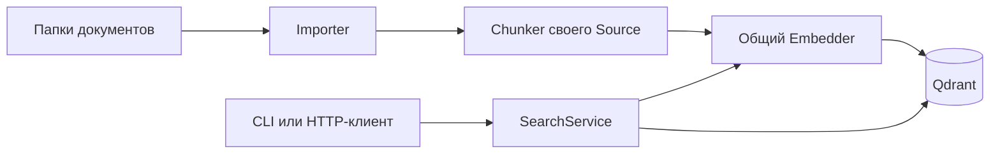

# Semantic Search

Локальный поиск по документам на Python 3.12+. Первая модель —
`intfloat/multilingual-e5-small`, вычисления на CPU через Sentence Transformers.
Документы, векторы и состояние индекса хранятся в Qdrant. SQLite и Ollama не нужны.

## Быстрый запуск в PowerShell

```powershell
cd D:\Projects\SemanticSearch
.\.venv\Scripts\Activate.ps1
python -m pip install -r requirements.lock -e ".[dev]"
semantic-search index
semantic-search search "Как бороться с переобучением?"
semantic-search serve
```

Окружение создаётся командой `python -m venv .venv`, если его ещё нет.
При первом обращении скачивается модель; затем используются локальные файлы из `.models`.
API по умолчанию слушает только `127.0.0.1:8000`; интерактивная документация — `/docs`.
`serve` не запускает индексацию автоматически: сначала выполните `index` или вызовите API.

Для проверки без загрузки модели: `python -m pytest`.
`requirements.lock` фиксирует проверенные версии зависимостей для Windows / Python 3.12.

## Источники и фильтры

В `config.toml` уже настроены два небольших демонстрационных Markdown-документа.
Для своих файлов добавьте секцию:

```toml
[[sources]]
path = 'C:\Users\TED\Documents\Obsidian Vault'
extensions = [".md"]
chunker = "markdown"
max_tokens = 384
overlap_tokens = 32
```

Пути в конфигурации разрешаются относительно самого TOML-файла.
Каждый источник получает импортёр и свой чанкер. Несколько источников индексируются
параллельно (по умолчанию два). Одна модель обрабатывает небольшие пакеты;
поисковые запросы имеют приоритет между пакетами документов.

```powershell
semantic-search sources
semantic-search index --source SOURCE_ID
semantic-search search "регуляризация" --directory 'C:\Users\TED\Documents\Obsidian Vault\DS'
semantic-search search "регуляризация" --source SOURCE_ID --limit 10
```

`source_id` — детерминированный UUID от нормализованного абсолютного пути корневой
папки. В метаданных сохраняются и сам путь, и точные пути всех родителей до корня
источника. Фильтр директории включает её потомков, но не одноимённые префиксы:
`DS` не включает `DS-old`. На Windows регистр пути нормализуется.
Перенос корня создаёт новый источник. Пересекающиеся источники независимы:
один файл может присутствовать в обоих. Поиск ограничен настроенными источниками.

Поддерживаются UTF-8 `.md` и `.txt`. Скрытые файлы/каталоги и символические ссылки
пропускаются. Ошибки чтения не скрываются. Недоступная папка не считается пустой:
так временное отключение диска не удаляет индекс.

## Структура

```text
src/semantic_search/
  schemas.py                 Document, Chunk, SearchResult и общие типы
  source.py                  Source: importer + chunker
  importers/
    base.py                  BaseImporter
    directory.py             DirectoryImporter
  chunkers/
    base.py                  BaseChunker
    token.py                 TokenChunker
    markdown.py              MarkdownChunker
  embedders/
    base.py                  BaseEmbedder
    sentence_transformer.py  SentenceTransformerEmbedder
  databases/
    base.py                  BaseDatabase
    qdrant.py                QdrantDatabase
  service.py                 SearchService: индексация и поиск
  api.py                     FastAPI
  main.py                    Настройка компонентов и CLI
```

Зависимости компонентов передаются обычными аргументами. Нет контейнера внедрения
зависимостей, системы плагинов или отдельного сервера очередей.



Чтобы добавить компонент, реализуйте его базовый класс в соответствующей папке и
создайте его в `main.py`. Оркестратор менять не нужно. Импортёр возвращает общие
`Document`, чанкер — `Chunk`; объекты сторонних библиотек не выходят из адаптеров.
Для будущих FB2/PDF преобразование формата в `Document` добавляется в слой импорта.
PDF/OCR сейчас не реализованы.

## Чанкинг и модели

`TokenChunker` ограничивает фактический ввод модели, включая префикс и специальные
токены. Предпочитает границы абзацев/предложений/слов, затем делит длинный текст.
`MarkdownChunker` дополнительно распознаёт настоящие Markdown-заголовки и добавляет
их иерархию. Комментарии внутри fenced code blocks заголовками не считаются.
YAML frontmatter исключается из текста для поиска; его теги пока не извлекаются.
Исходный текст чанка и контекст для эмбеддинга хранятся отдельно.
Чанк содержит строки и символьные смещения в прочитанном тексте документа.
Чрезмерно длинный блок кода/таблица может быть разделён ради лимита токенов.

E5 получает `query: ` перед запросом и `passage: ` перед документом, в том числе
на русском языке. Префиксы настраиваются в TOML. При выборе другой модели укажите
её требования: например, BGE-M3 не требует этих E5-префиксов.
Не допускается молчаливое обрезание длинного запроса: API вернёт ошибку.

## Обновления и совместимость

* Неизменившиеся документы пропускаются по хешу текста и метаданных.
* Удалённые файлы очищаются только после успешного полного обхода источника.
* Новые чанки записываются как отдельная ревизия. После записи всех векторов
  обновляется манифест документа и удаляются старые точки.
* Поиск проверяет активную ревизию: незавершённая запись не подменяет рабочий текст.
  Остатки неудачной записи удаляются при следующем успешном обновлении документа.
* Изменение чанкера/параметров импорта требует `index --rebuild --source SOURCE_ID`.
  Пока перестроение не завершено, источник недоступен для поиска.
* Изменение модели, её ревизии, префиксов или размерности требует **нового имени
  коллекции** и повторной индексации. Старый индекс автоматически не удаляется.

Манифесты находятся в отдельной коллекции Qdrant `<collection>__metadata` без
векторов. Это всё ещё одна БД. Смена локальных весов под тем же именем требует
изменить заданную `revision`; для Hugging Face используется разрешённый commit.

## Qdrant: локальный режим и отдельный сервер

Для запуска без инфраструктуры конфигурация использует встроенный режим Qdrant
с хранением в `.data/qdrant`. Его может открыть только один процесс: остановите
API перед запуском отдельной CLI-команды либо вызывайте `/index` через API.

Для отдельного сервера:

```powershell
docker compose up -d
```

Замените `path` в секции `[database]` на `url = "http://127.0.0.1:6333"`.
Приложение работает с тем же адаптером. Коллекция на сервере будет новой: выполните
индексацию. Поддерживается один процесс приложения с несколькими источниками;
запуск нескольких независимых писателей или `uvicorn --workers N` не предусмотрен.
Docker Compose сам по себе не настраивает автозапуск Docker при входе в Windows.

## HTTP API

* `GET /health` — приложение запущено.
* `GET /sources` — источники, настройки, готовность и признак индексации.
* `POST /index` — `{"source_ids": ["..."], "rebuild": false}`; `{}` индексирует все.
  Запрос ждёт завершения. Разные источники могут индексироваться параллельно.
* `POST /search` — `{"query": "...", "limit": 5, "directory": "C:/notes/DS"}`.
  Можно добавить `source_ids`. Результат содержит чанк, метаданные и cosine score.
  Score не является вероятностью правильного ответа.

Первый пример:

```powershell
Invoke-RestMethod -Method Post -Uri http://127.0.0.1:8000/index -ContentType 'application/json' -Body '{}'
$body = @{query='Как уменьшить переобучение?'; limit=3} | ConvertTo-Json
Invoke-RestMethod -Method Post -Uri http://127.0.0.1:8000/search -ContentType 'application/json; charset=utf-8' -Body ([Text.Encoding]::UTF8.GetBytes($body))
```

## Границы первой версии

Нет фонового наблюдателя папок, системного автозапуска, OCR, FB2, гибридного поиска,
переранжирования и нового Obsidian-клиента. Индексация запускается явно через CLI/API.
Следующие реализации добавляются после этого проверяемого сквозного сценария.
Для оценки качества отдельно нужен набор русскоязычных запросов с релевантными
документами: модульные тесты проверяют корректность, а не качество модели.
